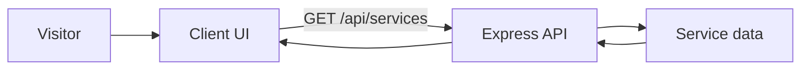

# Architecture and First Vertical Slice

## Boundaries
- Client: semantic UI, presentation and keyboard interaction.
- Server: read-only service data through `/api/services`.
- Docs: audit records, evidence and architecture decisions.
- Tests: automated accessibility regression checks.

## First vertical slice
Visitor opens the service directory → sees a skip link and page heading → searches services → activates a descriptive service link. Search is client-side; records are loaded from the API.

## Request flow


## Repository tree
```text
india-post-accessibility-audit/
├── client/
│   ├── index.html
│   ├── src/main.js
│   ├── src/style.css
│   └── vite.config.js
├── server/index.js
├── docs/
│   ├── accessibility-audit.csv
│   ├── audit-report.md
│   ├── architecture.md
│   └── test-plan.md
├── tests/accessibility.spec.js
├── playwright.config.js
├── package.json
└── README.md
```

## Decisions
Use semantic HTML before ARIA, native links for navigation, labelled search input, and a small API boundary. The demo collects no personal data and is not an official India Post service.
